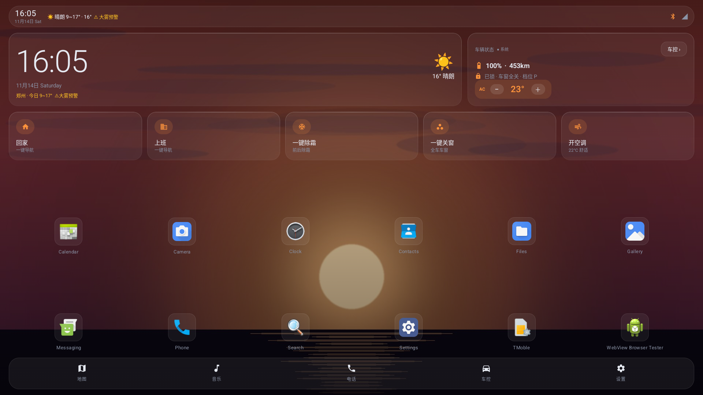
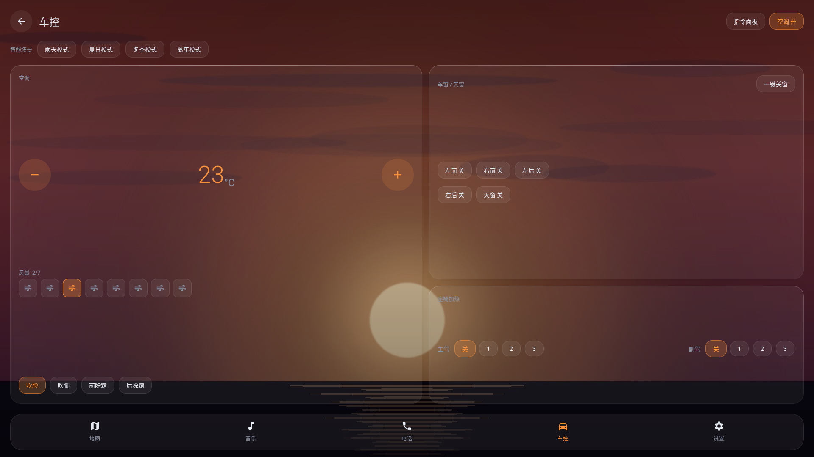
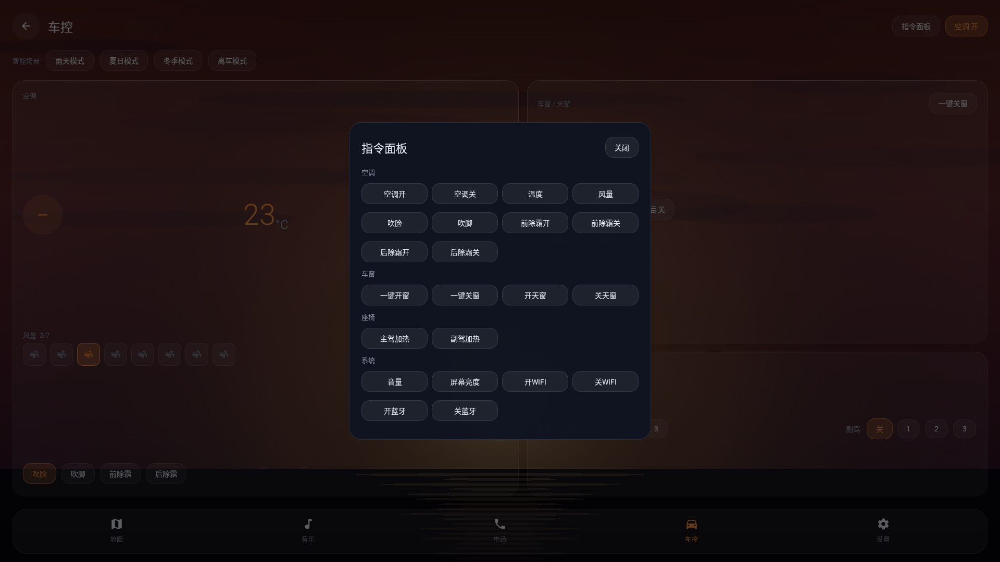
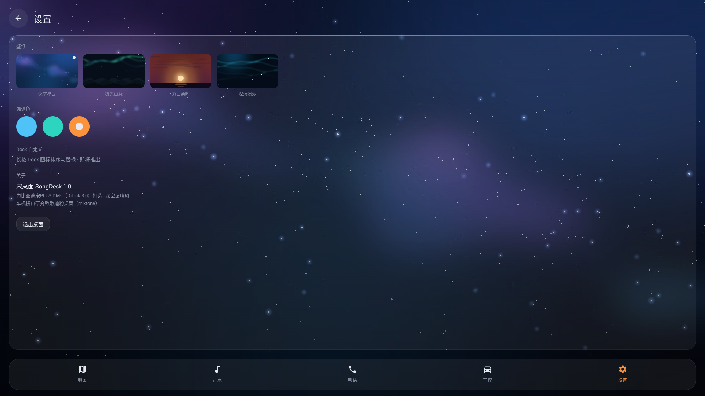

# 宋桌面 SongDesk

<p align="center">
  
</p>

**为比亚迪宋PLUS DM-i（2021 款 · DiLink 3.0）打造的开源车机桌面。** Kotlin + Jetpack Compose 全新实现，深空玻璃风设计——好看、好按、好开。

[产品文档](docs/PRODUCT.md) · [上车校准指南](docs/PRODUCT.md#7-上车校准指南)

## ✨ 特性

- **主页 1 步调温**：车况卡内置快速温控条（`AC − 23° ＋`），行驶中盲操可达，不用再进二级页
- **实时天气 + 气象预警**：MSN 国内源优先 / Open-Meteo 兜底，大雾、暴雨预警琥珀色高亮
- **快捷任务卡**：回家 / 上班（一键导航，高德车机版广播 + 深链降级）、一键除霜、一键关窗、开空调
- **车控面板**：空调温度/风量/吹风模式/前后除霜、四门车窗 + 天窗、双区座椅加热
- **智能场景**：雨天模式 / 夏日模式 / 冬季模式 / 离车模式，一键多步执行
- **指令面板**：19 条小迪风格指令（`温度:24`、`一键关窗`、`开WIFI`…）分类列出、点击执行
- **真实感壁纸**：4 张程序生成壁纸（深空星云 / 极光山脉 / 落日余晖 / 深海浪潮），设置页即点即换
- **诚实的数据来源**：车况卡标注「●实车 / ●系统 / ●模拟」，模拟数据绝不冒充实车
- **多级遥测架构**：真车广播 > 安装系统电瓶 > Mock 模拟，字段级优先级合并，真车数据一旦出现自动锁定

<p align="center">
  
  
</p>
<p align="center">
  
</p>

## 📲 安装

1. 下载 `app-debug.apk`（Releases）或自行构建
2. U 盘拷贝 → 车机安装（DiLink 允许第三方应用安装）
3. 打开宋桌面 → 系统设置里把它设为默认桌面

> 兼容目标：DiLink 3.0（Android 9/10）及以上横屏车机；其他安卓车机亦可尝试。

## 🛠 构建

```bash
# 需要 JDK 17 与 Android SDK 35
./gradlew assembleDebug
# 产物：app/build/outputs/apk/debug/app-debug.apk
```

模拟器调试：创建 1920×1080 @160dpi 的 AVD（不要选带打孔的 Pixel 设备定义）。

## 🧭 上车校准（开发者）

真车车况广播协议字段为推断。上车后：设置 → 开启「车机协议嗅探」→ `adb logcat -s SongDeskSniff` 抓取原车广播原始字段 → 按实际字段修改 `BroadcastTelemetryProvider` 解析映射。详见[产品文档](docs/PRODUCT.md)。

## 🗺 Roadmap

- [x] v1 三屏 UI / 程序化壁纸 / 快捷任务
- [x] v2 多级遥测架构 + 协议嗅探
- [x] v3 指令引擎 + 智能场景 + 指令面板
- [ ] v3.x 上车协议校准（需真车）
- [ ] v4 红绿灯读秒（高德车机版广播）
- [ ] v5 语音 TTS 播报（NaviTTSAIDL）
- [ ] v6 AI 助理（DeepSeek/GLM 可切换）
- [ ] v7 用户自定义场景编辑器

## ⚠️ 免责声明

本项目为个人学习与自用目的开发。空调/车窗等控制指令基于对第三方桌面协议的静态分析推断，**未经过比亚迪官方验证**；上车使用请先在停车状态验证每条指令的实际效果。转向灯、双闪等安全相关操作不在指令范围内。

## 🙏 致谢

- [迪粉桌面](https://www.miktone.com)（miktone）——车机接口研究的基础，本项目的接口知识源自对其公开分发 APK 的静态分析
- [frida-dexdump](https://github.com/hluwa/frida-dexdump) / [jadx](https://github.com/skylot/jadx) —— 逆向工具链
- [Open-Meteo](https://open-meteo.com) —— 免费天气数据

## License

MIT
